# HB/HE SiPM pulse shape with zero-suppression flags (HBHEChannelInfo)

*CMSSW_17_0_0_pre2 · run of 2026-09-28 · `default/` tree of the HCAL pulse-shape study*

## Summary

The MC HB charge-fraction distribution was flat, possibly because most of its
entries should be zero-suppressed. To test this, the analysis was changed to
(1) apply the `HBHEPhase1Reconstructor` drop flags
([L605](https://github.com/cms-sw/cmssw/blob/master/RecoLocalCalo/HcalRecProducers/src/HBHEPhase1Reconstructor.cc#L605))
and (2) run on `HBHEChannelInfo` instead of the digi collection
(`saveInfos = True`,
[cfi L45](https://github.com/cms-sw/cmssw/blob/master/RecoLocalCalo/HcalRecProducers/python/HBHEPhase1Reconstructor_cfi.py#L45)).

- **Both changes are in place.** The analysis now reads `HBHEChannelInfo` and keeps only
  channels with `!isDropped()`, which is exactly the set of channels reco turns into
  rechits. All 24 no-contamination checks pass.
- **The MC HB curve is no longer flat.** Its charge fraction in the sample of
  interest (SOI) rises from 0.14 to 0.57, close to MC reco shape 208 (0.59).
- **The ZS flags are applied, but the main cause of the flat shape was the pedestal.**
  - In MC, ZS flags 79 % of HB channels and removes about half of the old flat
    population above the charge cut. The remaining half still averages to a flat curve.
  - The pulse only appears once the **effective pedestal** (QIE pedestal + SiPM
    dark current) is subtracted. `HBHEChannelInfo` provides it; the old digi-based
    analysis subtracted only the QIE pedestal.
- **Where shapes 207 and 208 are placed in time decides how they compare.** They are
  1 ns lists; three placements are compared:

  | Placement | Array bin 0 at | 207, TS3 / TS4 | Section |
  |---|---|---|---|
  | Peak-centred (first plots) | 207: SOI start − 6 ns; 208: − 3 ns | 0.66 / 0.24 | 3.3 |
  | Unshifted (array dumped from the SOI start) | SOI start | 0.51 / 0.36 | 3.4 |
  | **As in RECO (Mahi)** | **SOI start − 7 ns**, both LUTs | **0.68 / 0.22** | **3.5** |

- **The RECO placement is the reference.** Mahi places every template with
  `iniTimeShift = 92.5 ns` (`PulseShapeFunctor.cc`), i.e. 7 ns before the SOI. For
  MC, the 7.2 ns shift in `Y11206()` is already inside shape 208. A Python port of the
  reco code reproduces the RECO placement exactly.
- **In the RECO placement, both MC and data pulses arrive later than the templates.**
  MC is about 4 ns later than shape 208, data about 6 ns (HE) to 9 ns (HB) later than
  shape 207. The earlier "data agrees with unshifted 207" (section 3.4) is real, but
  only because the unshifted placement is itself 7 ns later than reco's.
- With only 8 integrated time slices, timing and shape are partly degenerate
  (section 3.6).

## 1. Before: old digi-based analysis

The old analysis used unsuppressed MC digis (`simHcalUnsuppressedDigis`), its own
ADC→fC conversion, the QIE pedestal only, and no ZS. The selection was
ΣQ(8 TS) > 5000 fC.

<p align="center">
  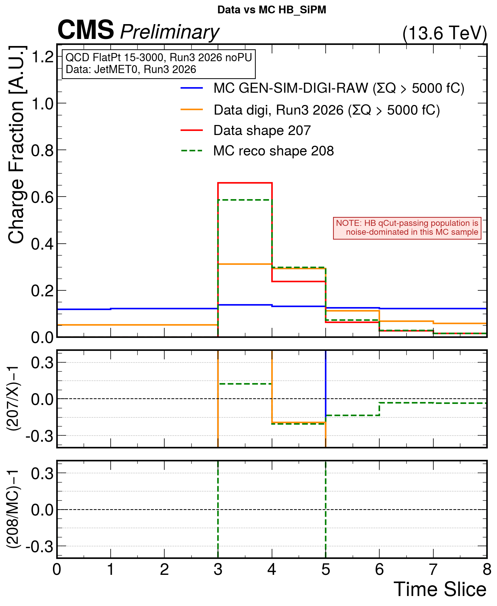
  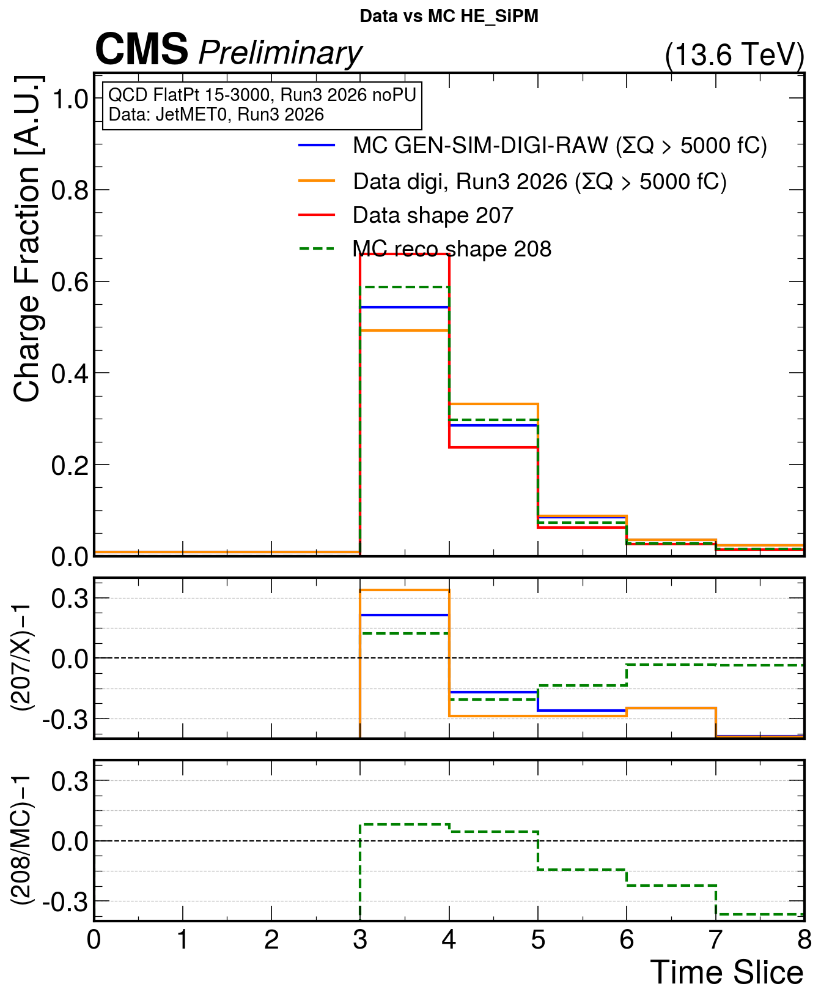
</p>

The MC HB curve (blue, left) is flat at about 0.12 per time slice, built from 743k
channels passing the cut. HE (right) already shows a pulse.

## 2. Implementation

### Chain

| Sample | ZS flag source | Reconstructor (`hbheInfo`, `HBHEPhase1Reconstructor` clone) | Analyzer |
|---|---|---|---|
| MC | `simHcalDigisMP`: realistic ZS (`HcalRealisticZS`, per-channel DB thresholds, Run-3 era settings) re-run on the unsuppressed digis with `markAndPass = True` | `saveInfos = True`, `dropZSmarkedPassed = True`, `saveDroppedInfos = True`, `makeRecHits = False` | `HBHEChannelInfoPulseAnalyzer` (`anaInfo`) |
| Data | hardware mark-and-pass bit in the unpacked `hcalDigis` | same | same |

The MC ZS step is needed because standard MC ZS (`simHcalDigis`, `markAndPass = False`)
*removes* suppressed channels instead of flagging them, so `zsMarkAndPass()` is never
set in MC.

The reconstructor sets, per channel
([L501–504, L605](https://github.com/cms-sw/cmssw/blob/master/RecoLocalCalo/HcalRecProducers/src/HBHEPhase1Reconstructor.cc#L605)):

```cpp
dropByZS = dropZSmarkedPassed && frame.zsMarkAndPass();
channelInfo->setChannelInfo(..., taggedBadByDb || dropByZS || badSOI);   // -> isDropped()
const bool makeThisRechit = !channelInfo->isDropped();
```

The analyzer:

- takes `tsCharge(ts) = rawCharge − pedestal` for 8 time slices, SOI at time slice 3
  (`use8ts`);
- applies ΣQ > 5000 fC;
- **skips `isDropped()` channels** in the main profile, the tree and the time-slew
  histogram;
- profiles the dropped channels separately (`frac_vs_ts_dropped_*`) as a diagnostic.

`saveDroppedInfos = True` keeps the dropped channels in the collection so they can be
counted. They never enter the result.

### Verified configuration

The values below come from the fully expanded configs (`edmConfigDump` / `runpy`, era
modifiers applied):

| Parameter | MC | Data |
|---|---|---|
| `saveInfos` | True | True |
| `dropZSmarkedPassed` | True | True |
| `saveDroppedInfos` | True | True |
| `digiLabelQIE11` | `simHcalDigisMP:HBHEQIE11DigiCollection` | `hcalDigis` |
| `saveEffectivePedestal` | True (`hbheInfo`) / False (`hbheInfoQIEPed`, cross-check) | same |
| `use8ts` / `tsFromDB` | True / False | True / False |
| `simHcalDigisMP.markAndPass` | True | n/a |
| `anaInfo.skipDropped` | True | True |

## 3. Results

### 3.1 Zero-suppression flag

| Sample | Channels read | Dropped (`isDropped`) | Dropped among channels with ΣQ > 5000 fC |
|---|---|---|---|
| MC HB | 9.07 M | **78.8 %** | 43 / 14,529 |
| MC HE | 6.77 M | **62.5 %** | 1,377 / 23,108 |
| Data HB | 11.0 M | 0.02 % | 0 |
| Data HE | 19.8 M | 0.05 % | 0 |

In data, hardware ZS already removes suppressed channels before readout, so the flag
has almost no effect. It is still applied, so data and MC are processed identically.

### 3.2 Separating the ZS effect from the pedestal effect

To separate the two effects, each job also runs a reconstructor clone with ZS applied
but the **QIE-only** pedestal (`saveEffectivePedestal = False`, directory
`anaInfoQIEPed/`). Each panel shows three curves:

- **black:** old analysis;
- **blue dashed:** ZS only;
- **red:** ZS + effective pedestal (final).

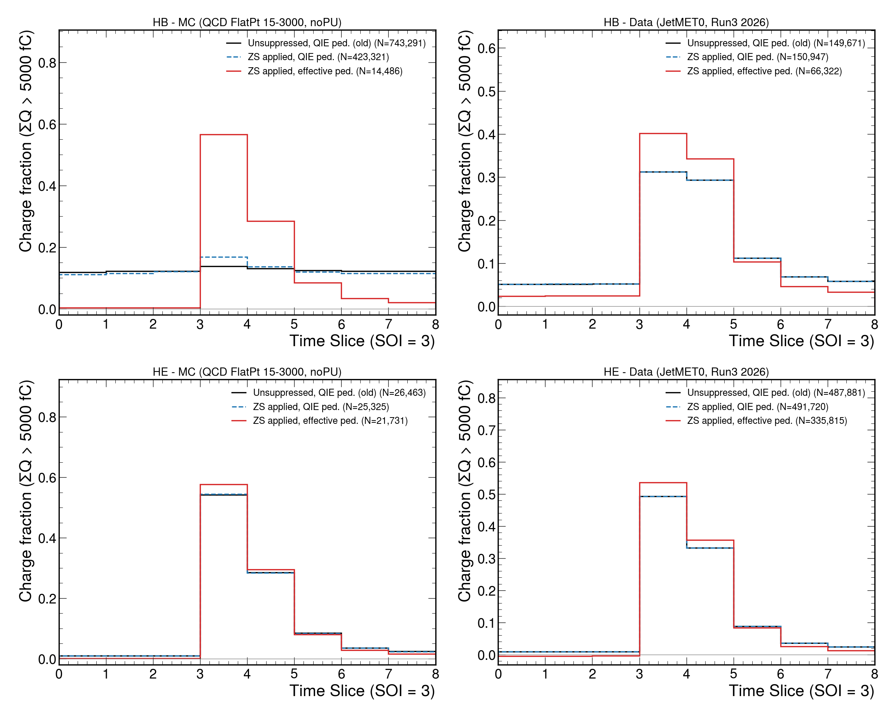

In the table, *peak* is the charge fraction in the SOI (time slice 3) and *pre-SOI* is
the summed fraction in time slices 0–2.

| | Old (no ZS, QIE ped.) | + ZS (QIE ped.) | + ZS, effective ped. (**final**) |
|---|---|---|---|
| **MC HB**: N kept / peak / pre-SOI | 743,291 / 0.138 / 0.362 | 423,321 / 0.168 / 0.346 | **14,486 / 0.566 / 0.011** |
| **MC HE** | 26,463 / 0.543 / 0.028 | 25,325 / 0.544 / 0.029 | **21,731 / 0.578 / 0.003** |
| **Data HB** | 149,671 / 0.313 / 0.155 | 150,947 / 0.312 / 0.156 | **66,322 / 0.401 / 0.073** |
| **Data HE** | 487,881 / 0.492 / 0.028 | 491,720 / 0.492 / 0.028 | **335,815 / 0.535 / −0.013** |

**MC HB, step by step:**

- **ZS** removes 396k of the 819k channels above the cut, but the kept channels are
  still flat.
- **Subtracting the dark-current pedestal** removes almost all the rest
  (423k → 14.5k) and reveals the pulse.
- **The old flat curve was a leftover pedestal.** A pedestal left in all 8 time slices
  gives a flat profile, with ΣQ sitting just above the cut (old median ≈ 5.2k fC),
  matching the old HB curve.

HE is only mildly affected: the peak goes from 0.54 to 0.58. In data, ZS changes
nothing and the effective pedestal sharpens the peak.

### 3.3 After: comparison with the target shapes, peak-centred LUTs

Here each LUT is integrated into 25 ns slices with its peak placed at the centre of the
SOI bin, the convention used by all earlier versions of these plots. This is an
implicit time shift: **−6 ns for shape 207** (peak at bin 18) and **−3 ns for shape
208** (peak at bin 15), relative to the arrays as stored in CMSSW. Section 3.4 shows
the same comparison without this shift.

<p align="center">
  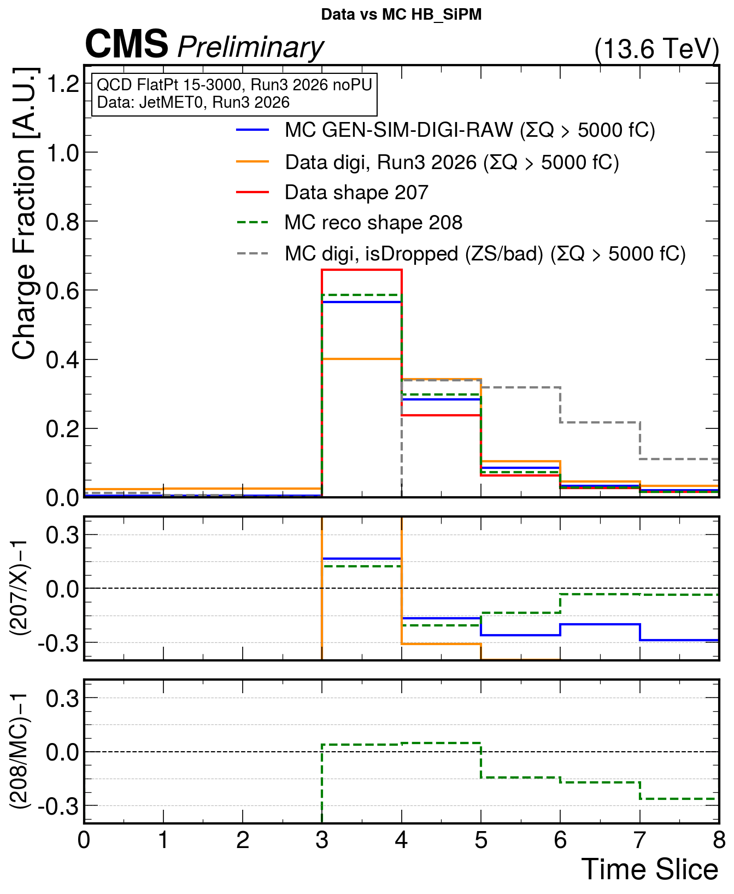
  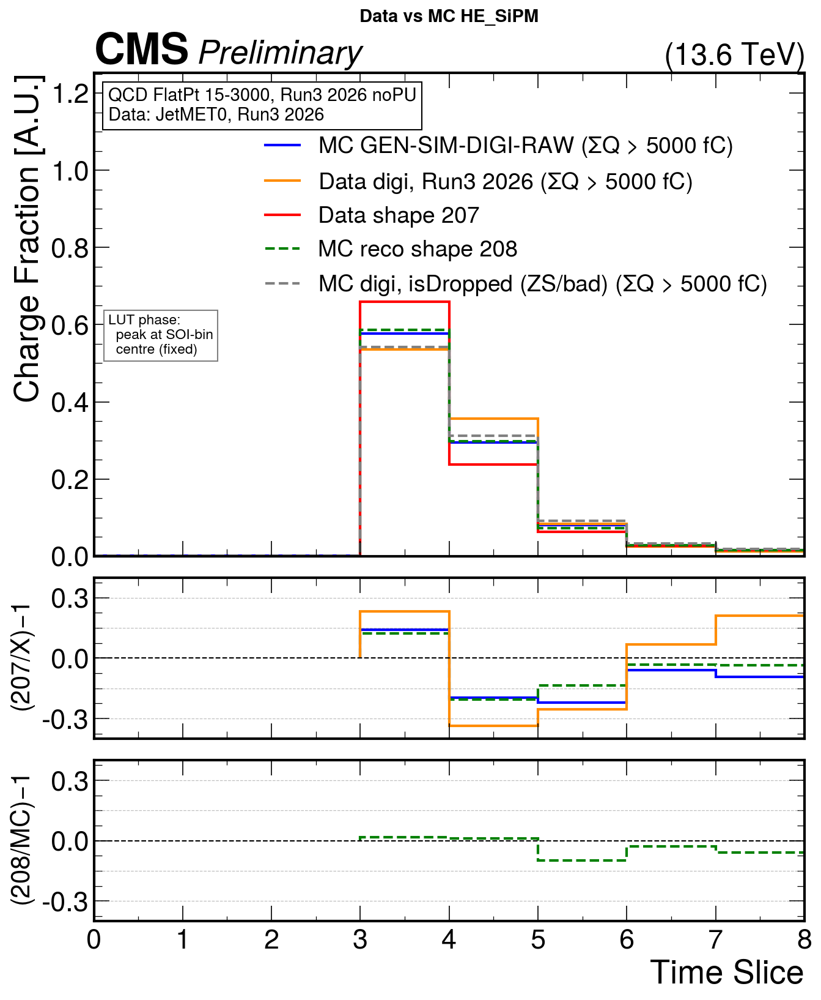
</p>

On these plots:

- **Blue:** MC digi.
- **Orange:** data digi.
- **Red:** data shape 207.
- **Green dashed:** MC reco shape 208, which is simulation-derived, not data.
- **Grey dashed:** dropped MC channels passing the charge cut, for illustration only.
  They are not part of the result.

| Charge fraction | Shape 207 (data LUT, −6 ns) | MC reco 208 (−3 ns) | MC digi | Data digi |
|---|---|---|---|---|
| HB, SOI (time slice 3) | 0.66 | 0.59 | 0.57 | 0.40 |
| HB, time slice 4 | 0.24 | 0.30 | 0.28 | 0.34 |
| HE, SOI (time slice 3) | 0.66 | 0.59 | 0.58 | 0.54 |
| HE, time slice 4 | 0.24 | 0.30 | 0.30 | 0.36 |

- **MC digi agrees with shape 208 to within a few %** in both HB and HE, but only
  because 208 is shifted −3 ns here. Placed as in RECO (section 3.5), 208 is 4 ns
  earlier still, and MC no longer matches it.
- **Both MC and data put less charge in the SOI and more in time slice 4 than shape
  207.** The peak-centred 207 is within 1 ns of RECO's placement, so this is close to
  what reco sees: the digi pulses arrive later than the template (section 3.5).
- **Data is noticeably later or broader than shape 207 in this placement.** Section
  3.6 shows that a timing shift plus a flat baseline accounts for it.
- **The grey dropped HB curve starts at time slice 4 by construction.**
  - The Run-3 ZS keeps a channel only if the ADC count in the SOI passes the
    channel's threshold.
  - Channels that were dropped and still pass the charge cut therefore have almost
    no charge in the SOI, so their charge sits in later time slices.
  - It is 43 channels and is not part of the result.
- **The dropped HE channels above the cut (grey) have a genuine pulse shape.** They are
  probably tagged bad in the database rather than ZS noise; `isDropped()` does not
  separate the two.

### 3.4 Comparison with unshifted LUTs (array as stored)

**What changes.** Shapes 207 and 208 are lists of 250 numbers, one per nanosecond. To
compare them with the digis, each list is placed on the time axis and summed in 25 ns
time slices. Where the list starts decides how its charge splits between time slices
3 and 4:

- **Peak-centred (section 3.3):** the list is moved so that its peak sits in the middle
  of time slice 3. This moves 207 6 ns earlier and 208 3 ns earlier than stored.
- **Unshifted (this section):** the list starts at the beginning of time slice 3
  (75 ns), exactly as stored in CMSSW
  ([`HcalPulseShapes.cc`](https://github.com/cms-sw/cmssw/blob/master/CalibCalorimetry/HcalAlgos/src/HcalPulseShapes.cc#L327)).
  The 207 peak then falls at 93–94 ns.

Only the red (207) and green (208) curves move between the two placements; the
measured MC and data curves are identical.

**HB:** peak-centred (left) and unshifted (right)
<p align="center">
  
  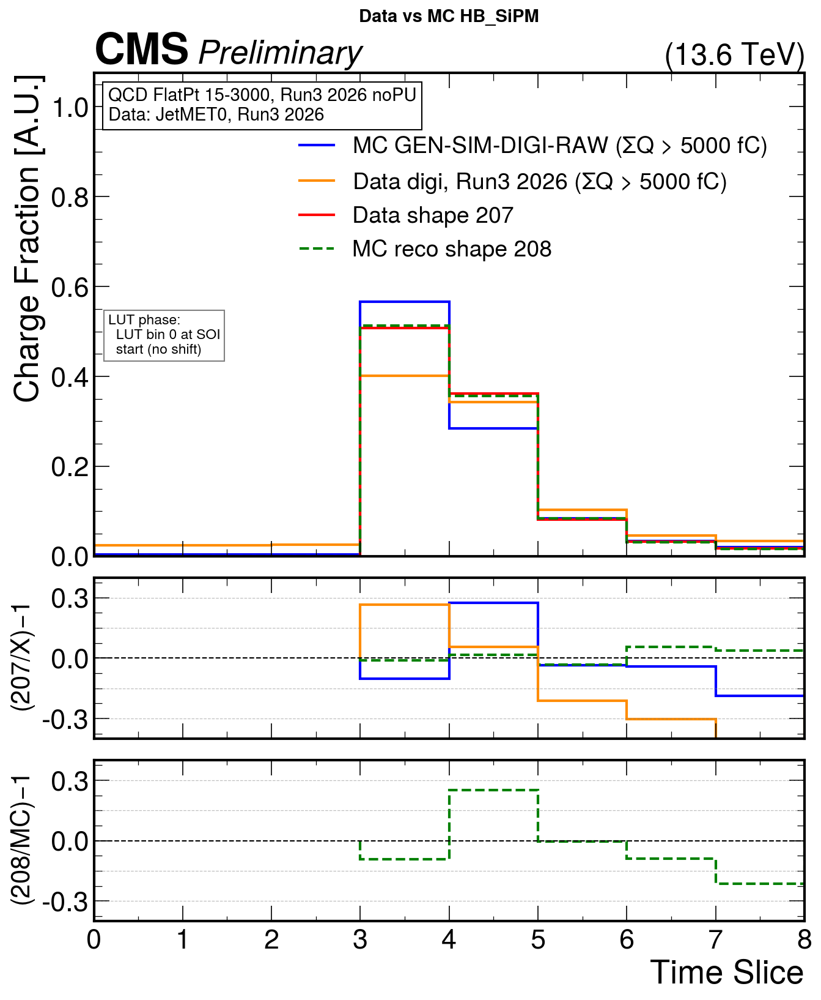
</p>

**HE:** peak-centred (left) and unshifted (right)
<p align="center">
  
  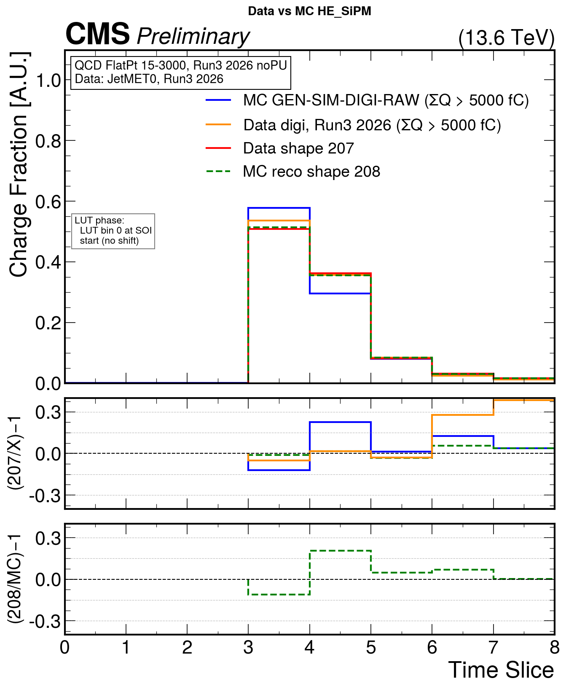
</p>

**How the LUTs change** (charge fraction in time slices 3 / 4 / 5):

| | Peak-centred | Unshifted |
|---|---|---|
| Shape 207 | 0.66 / 0.24 / 0.06 | **0.51 / 0.36 / 0.08** |
| Shape 208 | 0.59 / 0.30 / 0.07 | **0.51 / 0.36 / 0.08** |

**How well each curve matches** (rms difference per time slice over time slices 3–7,
no baseline subtraction; lower is better):

| | Data vs 207 | MC vs 208 |
|---|---|---|
| HB, peak-centred | 0.127 | **0.013** |
| HB, unshifted | **0.050** | 0.040 |
| HE, peak-centred | 0.078 | **0.006** |
| HE, unshifted | **0.013** | 0.039 |

**What this shows:**

- **Data matches 207 much better when 207 is not shifted.** In HE the agreement is
  within a few % in every time slice, so the shape of the data pulse is consistent
  with 207; the disagreement in section 3.3 is a timing difference.
- **HB data still has a lower SOI fraction** (0.40 against 0.51). Part of this is its
  flat +0.024 per time slice before the SOI (pileup or residual pedestal), which is not
  subtracted here. With it removed, HB data matches 207 within 1 ns of this placement
  (section 3.6).
- **This is not where RECO places the LUTs.** Reco starts them 7 ns earlier
  (section 3.5). The good data–207 agreement here therefore means the data pulses sit
  about 7 ns later than RECO's 207 template.
- **MC now sits about 3 ns earlier than the stored 208.** The close MC–208 agreement in
  section 3.3 relied on the −3 ns shift of 208.
- **Unshifted, 207 and 208 are almost the same** over 8 time slices.

### 3.5 Comparison with LUTs placed as in RECO (Mahi)

**Where reco places the template.** Mahi builds its pulse template from shape 207
(data) or 208 (MC) with `PulseShapeFunctor::funcShape`
([`PulseShapeFunctor.cc` L82](https://github.com/cms-sw/cmssw/blob/master/RecoLocalCalo/HcalRecAlgos/src/PulseShapeFunctor.cc#L82)):

- The array starts at `i_start = int(iniTimeShift + t0) + 1` ns in a 10-time-slice
  frame where the SOI (time slice 4) starts at 100 ns, with
  `iniTimeShift = 92.5 ns` (`HcalConstants.h`).
- `t0 = meanTime + time-slew delay(Q)`. `meanTime = 0`, and the HcalTimeSlew "Medium"
  delay, `11.98 − 1.56 ln Q[fC]` clamped to [0, 10] ns, is 0 for every channel
  passing the 5000 fC cut.
- So the array starts at 93 ns, **7 ns before the SOI**, for data and MC alike.
  Mahi then maps the frame onto the 8-time-slice window (`delta = 4 − SOI`).
- **The MC timing shift** is the `shift = 7.2` ns in `Y11206()`
  ([`HcalPulseShapes.cc` L612–615](https://github.com/cms-sw/cmssw/blob/master/CalibCalorimetry/HcalAlgos/src/HcalPulseShapes.cc#L612-L615)).
  It delays the simulated photon arrival and is built into shape 206. Shape 208 is
  "206 with the 7.2 ns shift", so it is already inside the 208 array; reco then places
  208 like 207.

A Python port of `funcShape` and of Mahi's indexing gives 207 = 0.678 / 0.221 / 0.060
and 208 = 0.668 / 0.234 / 0.060 in time slices 3 / 4 / 5. `plot_from_fc.py
--lut-align reco` (array bin 0 at SOI start − 7 ns) gives exactly the same numbers.

<p align="center">
  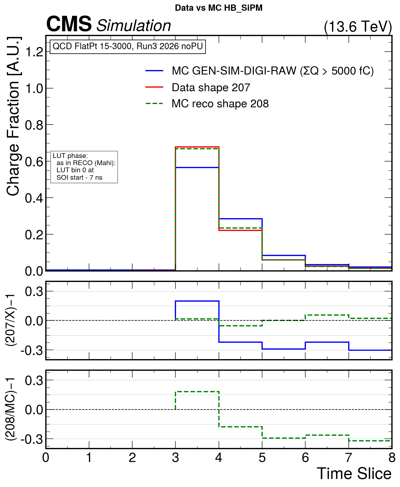
  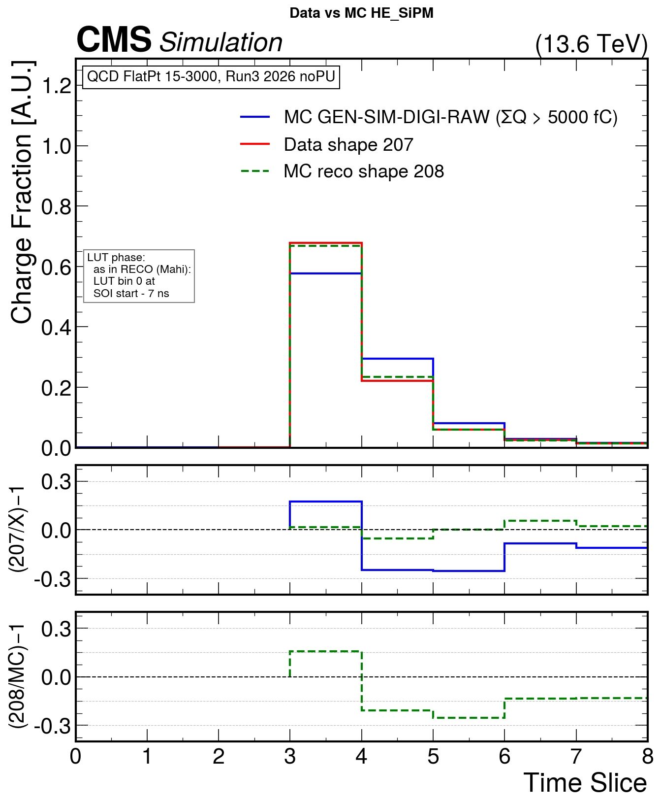
</p>

*These two plots show MC only. The data file of this tree has to be regenerated
(section 5); the data numbers below are from the same run-401642 data used in the
other sections.*

**The three placements side by side** (charge fraction in time slices 3 / 4 / 5):

| | Peak-centred (3.3) | Unshifted (3.4) | **As in RECO** |
|---|---|---|---|
| Shape 207 | 0.66 / 0.24 / 0.06 | 0.51 / 0.36 / 0.08 | **0.68 / 0.22 / 0.06** |
| Shape 208 | 0.59 / 0.30 / 0.07 | 0.51 / 0.36 / 0.08 | **0.67 / 0.23 / 0.06** |
| MC digi, HB / HE | 0.57 / 0.28 and 0.58 / 0.30 | same | same |
| Data digi, HB / HE | 0.40 / 0.34 and 0.54 / 0.36 | same | same |

**How well the digis match the RECO-placed templates** (rms per time slice over time
slices 3–7, no baseline subtraction):

| | rms, RECO placement | Extra delay of the digi pulse that fits best | rms at that delay |
|---|---|---|---|
| HB: MC vs 208 | 0.052 | **+4 ns** | 0.013 |
| HE: MC vs 208 | 0.050 | **+4 ns** | 0.006 |
| HB: data vs 207 | 0.137 | **+9 ns** | 0.040 |
| HE: data vs 207 | 0.089 | **+6 ns** | 0.010 |

**What this shows:**

- **Both MC and data pulses arrive later than RECO's templates.** The templates put
  0.67–0.68 of the charge in the SOI; MC has 0.57–0.58, data 0.40 (HB) and 0.54 (HE).
- **MC is about 4 ns later than RECO's 208.** The digitizer timing in this MC
  (including the 7.2 ns in `Y11206()` and the simulation `timePhase`) does not put the
  pulse where reco's template expects it. That is worth checking against the MC
  timing conditions used for this sample.
- **Data is about 6 ns (HE) to 9 ns (HB) later than RECO's 207.** The HB number also
  absorbs the flat +0.024 per time slice baseline, which is not subtracted here.
- **The earlier placements hid or reversed this.** The peak-centred placement is
  1 ns from reco for 207 but 4 ns for 208. The unshifted placement is 7 ns later than
  reco, which is why data matched it.
- **Reco may absorb part of this offset elsewhere.** Per-channel timing settings or
  conditions that this analysis does not apply could account for it; the time
  reconstructed by Mahi in data would show whether it does.

### 3.6 Comparison with fitted LUT phase and baseline subtraction

The placement in 3.3 is an assumption, not a measurement. If the data pulses arrive
at a different phase, charge moves between time slices 3 and 4, and the fractions
disagree even when the shape is the same. Starting from the peak-centred placement,
the plots below:

- **fit the time shift of each LUT** (1 ns steps, ±40 ns, rms over time slices ≥ SOI):
  shape 207 to data digi, shape 208 to MC digi;
- **subtract the flat pre-SOI baseline** (mean of time slices 0–2) from each digi
  curve and renormalize. This baseline comes from pileup or residual pedestal, and
  the LUTs have none.

<p align="center">
  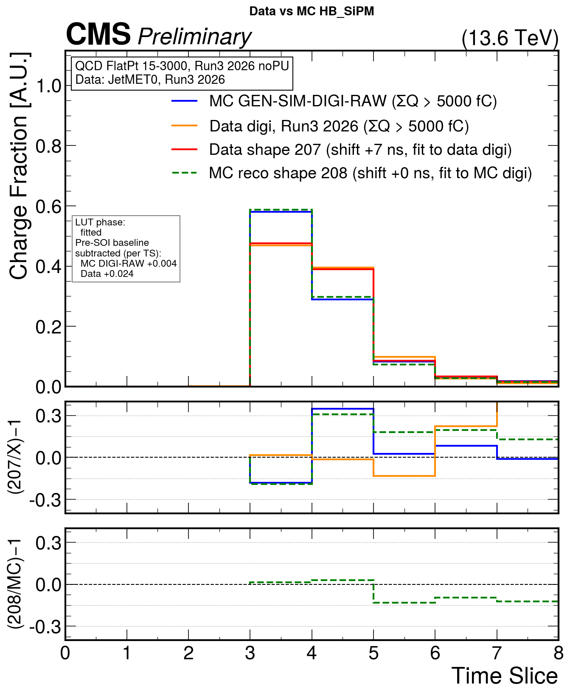
  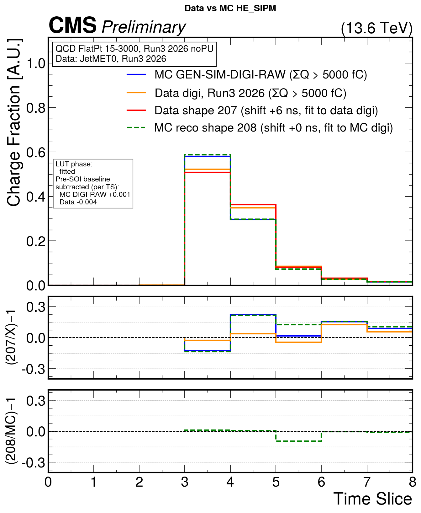
</p>

| | Fitted shift | rms per time slice | Baseline subtracted (per time slice) |
|---|---|---|---|
| HB: shape 207 vs data digi | **+7 ns** | 0.008 | data +0.024 |
| HE: shape 207 vs data digi | **+6 ns** | 0.009 | data −0.004 |
| HB: shape 208 vs MC digi | 0 ns | 0.007 | MC +0.004 |
| HE: shape 208 vs MC digi | 0 ns | 0.005 | MC +0.001 |

For comparison, the rms of data vs 207 at the peak-centred placement is 0.127 (HB) and
0.078 (HE).

The shifts are measured from the peak-centred placement. Relative to the arrays as
stored (section 3.4):

| | Shift vs peak-centred | Shift vs unshifted array | **Shift vs RECO placement** |
|---|---|---|---|
| HB: shape 207 vs data digi | +7 ns | +1 ns | **+8 ns** |
| HE: shape 207 vs data digi | +6 ns | 0 ns | **+7 ns** |
| HB / HE: shape 208 vs MC digi | 0 ns | −3 ns | **+4 ns** |

HB time slices 3–5 after the fit:

| | TS3 | TS4 | TS5 |
|---|---|---|---|
| Data digi | 0.468 | 0.395 | 0.098 |
| Shape 207 (+7 ns) | 0.475 | 0.389 | 0.085 |

- **Data matches shape 207 as closely as MC matches shape 208.** The data ratio in the
  first ratio panel is within about ±0.1 for both HB and HE.
- **Relative to where RECO places the templates, data is 7–8 ns late and MC 4 ns
  late.** These are the offsets that matter for reconstruction (section 3.5). Relative
  to the unshifted array, data happens to sit at 0 / +1 ns, because that placement is
  itself 7 ns later than reco's.
- **Both offsets are worth following up** (caveat 6): the MC one against the MC
  timing settings, the data one against the time Mahi reconstructs in data.
- **The phase fit and the shape are not independent.** With only 8 integrated 25 ns
  bins, a shift can absorb part of a shape difference: shape 208 also fits HE data at
  +2 ns with rms 0.010. These plots show that data is consistent with 207, not that 207
  is uniquely the right shape. Validating the shape needs the phase from an
  independent source (caveat 6).

### 3.7 No-contamination checks

`check_outputs.py` runs over MC/data × HB/HE × `anaInfo` / `anaInfoQIEPed`, which is
24 checks. **All pass.** It checks that:

- no dropped channel is in the output tree;
- profile entries = tree entries = channels passing the cut and not dropped;
- passing − kept = dropped-profile entries;
- the SOI is at time slice 3 for every channel;
- the channel counters are not saturated.

## 4. Caveats and next steps

1. **Pileup.** The MC has no pileup; the data has pileup. Pileup from earlier bunch
   crossings is expected to raise the pre-SOI and time-slice-4 fractions in data
   (e.g. HB pre-SOI 0.073 in data vs 0.011 in MC). A pileup MC sample is needed for a
   fair data/MC shape comparison.
2. **Data statistics.** Only one JetMET0 file (run 401642) was processed; more runs
   and files are needed.
3. **Data HE pre-SOI is slightly negative (−0.013).** The effective pedestal
   over-subtracts a little in data, so the dark-current values in the data conditions
   should be checked.
4. **`isDropped()` covers more than ZS.** It includes ZS, bad-in-database and bad-SOI
   channels. For the result this is the right selection, since it matches the rechit
   selection exactly, but it cannot isolate ZS alone.
5. **The charge cut now applies to dark-current-subtracted charge.** The kept channels
   have a median raw energy of ~4–7 GeV, consistent with the 4 GeV isotrack
   convention. The cut could be restated as an explicit energy cut.
6. **Timing offsets against RECO's templates.** With the LUTs placed as Mahi places
   them (section 3.5), MC pulses are about 4 ns and data pulses about 7–8 ns later
   than the templates. The fitted offsets (section 3.6) are partly degenerate with the
   shape. Next checks: the time Mahi reconstructs for these channels (data and MC), the
   TDC timing that `HBHEChannelInfo` provides in data, and the MC timing settings
   (`timePhase` in `hcalSimParameters_cfi.py`, the 7.2 ns in `Y11206()`).

## 5. Reproducing

```bash
cd /afs/cern.ch/work/p/ptiwari/public/hcal/default/CMSSW_17_0_0_pre2/src/HCALPulse/pulse_shape_study/test
./run_all.sh        # scram b -> cmsRun MC + data -> plots -> check_outputs.py
```

The RECO-placement plots in section 3.5 currently show MC only: this tree's
`edmHcalPulseShape_data.root` was overwritten by a data job that could not read its
input. Rerunning the data step (`cmsRun hcalpulse_data_raw_cfg.py`) and then
`./run_all.sh --plots-only` restores the data curve in all plot sets.

| File | Role |
|---|---|
| `plugins/HBHEChannelInfoPulseAnalyzer.cc` | new analyzer reading `HBHEChannelInfo` |
| `test/hcalpulse_gensimdigiraw_cfg.py`, `hcalpulse_gensim_cfg.py`, `hcalpulse_data_raw_cfg.py` | ZS flags + `saveInfos = True` reconstructor clones |
| `test/plot_from_fc.py` | peak-centred: `--dir anaInfo --tag _chinfo --show-dropped`; unshifted: `--dir anaInfo --tag _chinfo_unshifted --lut-align soi-start`; as in RECO: `--dir anaInfo --tag _chinfo_reco --lut-align reco`; fitted: `--dir anaInfo --tag _chinfo_fit --fit-phase --subtract-baseline` |
| `test/plot_zs_pedestal_check.py` | three-step ZS vs pedestal plot |
| `test/check_outputs.py` | no-contamination checks |
| `test/run_all.sh` | full workflow; logs in `test/logs/` |

No core CMSSW file was modified. `RecoLocalCalo/HcalRecProducers` is checked out
unmodified as a reference; the reconstructor settings are overridden only through
cfg clones.
